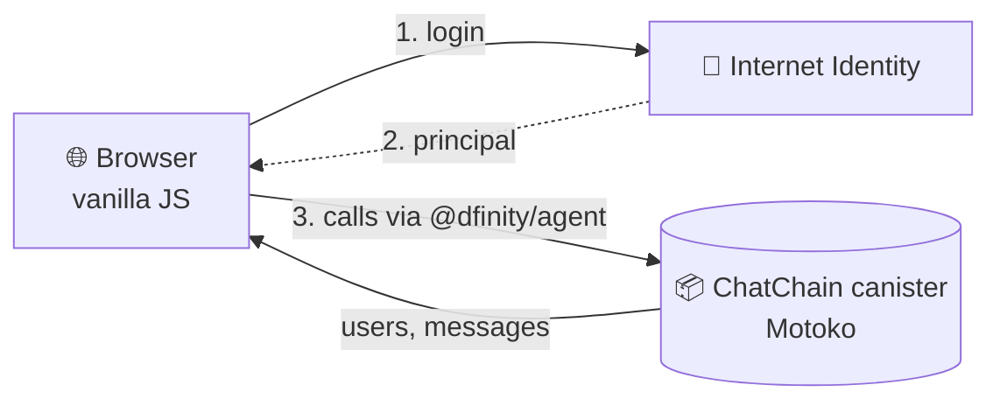
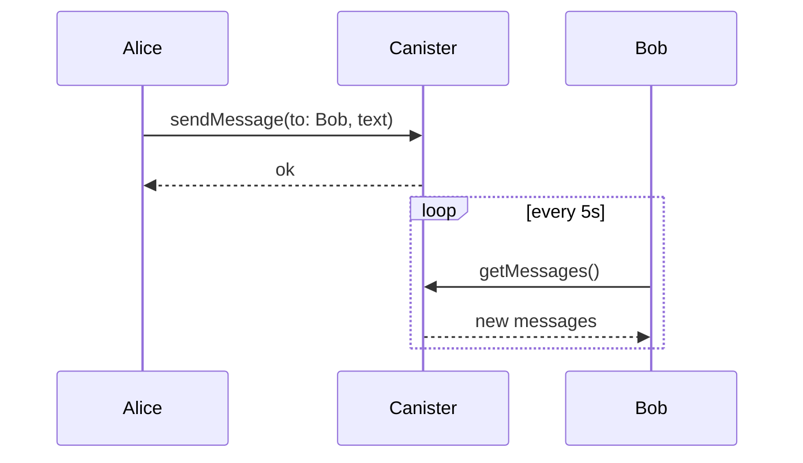

<div align="center">


[](LICENSE)
[](https://internetcomputer.org/)
[](https://internetcomputer.org/docs/current/motoko/main/motoko)
[](https://developer.mozilla.org/en-US/docs/Web/JavaScript)
[](https://webpack.js.org/)
[](CONTRIBUTING.md)

<br />

[🎬 Demo](#-demo) •
[✨ Features](#-features) •
[⚡ Quick Start](#-quick-start) •
[🧠 Architecture](#-architecture) •
[🚀 Mainnet](#-deploy-to-mainnet) •
[🛠️ Troubleshooting](#%EF%B8%8F-troubleshooting) •
[🗺️ Roadmap](#%EF%B8%8F-roadmap)

</div>

---

## 📖 Overview

ChatChain is a chat app that runs entirely on the **Internet Computer Protocol (ICP)**. A Motoko canister stores users and messages, **Internet Identity** handles passwordless login, and the frontend is plain JavaScript, HTML, and CSS, so it is easy to read, fork, and extend.

**Why build chat on a canister?** There is no server to rent, patch, or scale. The canister is both your backend and your database, and users sign in without passwords.

## 🎬 Demo

<!-- Replace with a real GIF: two browser windows, log in, register, send a message, see it arrive. -->
<div align="center">
  
</div>

## ✨ Features

| | Feature | Description |
|---|---|---|
| 🔗 | **Decentralized messaging** | Users and messages live in an ICP canister, with no central server |
| 🔐 | **Internet Identity** | Passwordless, privacy-preserving sign-in |
| 📱 | **Responsive UI** | Gradient interface with a user list, chat window, and settings modal |
| 🔄 | **Live updates** | The client polls for new messages every 5 seconds |
| 🌐 | **Easy to extend** | Vanilla JS and Motoko, with no framework to learn |

## ⚡ Quick Start

### Prerequisites


```bash
# Install the DFX SDK
sh -ci "$(curl -fsSL https://internetcomputer.org/install.sh)"

# Verify
dfx --version
node --version
```

### Run locally

```bash
git clone https://github.com/KelvCodes/ChatChain.git
cd ChatChain
npm install

dfx start --background   # local replica
dfx deploy               # deploy canisters
```

Set your backend canister ID in `src/frontend/assets/js/index.js`:

```js
const canisterId = '<your-backend-canister-id>'; // dfx canister id ChatChain_backend
const host = 'http://127.0.0.1:4943';
```

Start the frontend:

```bash
npm start
```

Open **http://localhost:9000**.

> [!TIP]
> Get your canister ID with `dfx canister id ChatChain_backend`.

### Try it out

1. Open the app and click the gear icon to log in with **Internet Identity**.
2. Enter a username to register.
3. Open a second browser profile or private window and register another user.
4. Pick the other user from the list and send a message.
5. Switch windows. The message shows up within 5 seconds.

## 🧠 Architecture





<details>
<summary><b>📁 Project structure</b></summary>

```text
ChatChain/
├── src/
│   ├── frontend/
│   │   ├── assets/
│   │   │   ├── css/styles.css
│   │   │   └── js/index.js
│   │   ├── declarations/ChatChain/    # Generated bindings
│   │   └── index.html
│   └── backend/
│       └── main.mo                    # Motoko canister
├── dfx.json
├── package.json
└── webpack.config.js
```

</details>

### Local vs mainnet

| | 🏠 Local | 🌍 Mainnet |
|---|---|---|
| **Host** | `http://127.0.0.1:4943` | `https://icp-api.io` |
| **Internet Identity** | Deploy your own local copy | `https://identity.ic0.app` |
| **Root key** | Must be fetched by the agent | Built in, never fetch it |
| **Cost** | Free | Costs cycles |
| **Data** | Wiped with `--clean` | Persists (see stable storage below) |

## 🚀 Deploy to Mainnet

```bash
dfx deploy --network ic
```

Update `index.js`:

```js
const canisterId = '<your-mainnet-backend-canister-id>';
const host = 'https://icp-api.io';
```

Your app will be live at `https://<frontend-canister-id>.icp0.io`. You can also host the frontend elsewhere (for example on Vercel) and point it at the mainnet backend canister.

> [!IMPORTANT]
> Mainnet deploys cost cycles. Make sure your cycles wallet is funded before running `dfx deploy --network ic`.

## 💾 Making Data Survive Upgrades

By default, Motoko variables are wiped when you upgrade a canister. To keep messages, store the data in `stable` variables. A common pattern is to keep a stable array and rebuild your working structure around upgrades:

```motoko
import HashMap "mo:base/HashMap";
import Iter "mo:base/Iter";
import Principal "mo:base/Principal";

actor {
  stable var userEntries : [(Principal, Text)] = [];
  var users = HashMap.fromIter<Principal, Text>(
    userEntries.vals(), 10, Principal.equal, Principal.hash
  );

  system func preupgrade() {
    userEntries := Iter.toArray(users.entries());
  };

  system func postupgrade() {
    userEntries := [];
  };
}
```

Apply the same pattern to messages. The exact types depend on your `main.mo`, so adapt the names to match.

## 🛠️ Troubleshooting

| Problem | Fix |
|---|---|
| `dfx: command not found` | Restart your terminal, or add `~/.local/share/dfx/bin` to your `PATH` |
| Frontend can't reach the canister | Check `canisterId` and `host` in `index.js`, and make sure `dfx start` is running |
| Certificate or signature errors locally | When using the local replica, call `agent.fetchRootKey()` before making requests, and skip it on mainnet |
| Login does nothing locally | Deploy a local Internet Identity (see below) and use its canister ID |
| Old data or schema after changes | Run `dfx generate ChatChain_backend`, then redeploy |
| Everything vanished after a restart | You started with `--clean`, or data isn't stable (see above) |
| Mainnet deploy fails | Check your cycles balance and that you passed `--network ic` |

<details>
<summary><b>🔐 Run Internet Identity locally</b></summary>

```bash
dfx deploy internet_identity --network local
```

Then put the local Internet Identity canister ID into `index.js`, and use its local URL as the identity provider.

</details>

<details>
<summary><b>🔄 Regenerate canister bindings</b></summary>

Run this after changing `main.mo`:

```bash
dfx generate ChatChain_backend
```

</details>

<details>
<summary><b>🧹 Reset local state</b></summary>

```bash
dfx start --clean --background
```

</details>

## 🧰 Tech Stack

| Layer | Technology |
|---|---|
| Smart contract |  |
| Blockchain |  |
| Auth | Internet Identity |
| Frontend |    |
| Bundler |  |
| ICP libraries | `@dfinity/agent`, `@dfinity/auth-client`, `@dfinity/identity` |
| SDK | DFX 0.15+ |

## 🔒 Security Notes

> [!WARNING]
> ChatChain is a learning project and is not production-ready.

- **Messages are not end-to-end encrypted.** Canister state can be read by the canister's controllers and node providers, so don't send secrets.
- **Registration is not enforced yet.** Unregistered principals can still send messages. The fix belongs in the canister, not only the UI.
- **Always check the caller in Motoko.** Never trust a sender ID sent from the frontend. Use the caller principal and reject anonymous calls.
- **Polling is not a rate limit.** Without limits, any user can spam the canister.

## 🗺️ Roadmap

- [x] Internet Identity login
- [x] User registration
- [x] On-canister messaging
- [x] Polling for new messages
- [ ] Stable storage so data survives upgrades
- [ ] Enforce registration and caller checks in the canister
- [ ] Private messages scoped to recipient principals
- [ ] Pagination for message history
- [ ] Message deletion with auth checks
- [ ] Real online and offline presence
- [ ] Rate limiting and message size limits
- [ ] File sharing (metadata on-chain, large files across canisters)

## 🤝 Contributing

Contributions are welcome, whether it's a bug fix, a feature, docs, or an idea.

```bash
git checkout -b feature/your-feature
git commit -m "Add your feature"
git push origin feature/your-feature
```

Then open a Pull Request.

## 📄 License

Released under the [MIT License](LICENSE).

<div align="center">

<br />

Built with 🖤 on the Internet Computer. No servers, no limits.

[](https://github.com/KelvCodes)

⭐ **Star this repo if you like decentralized apps.**

</div>
