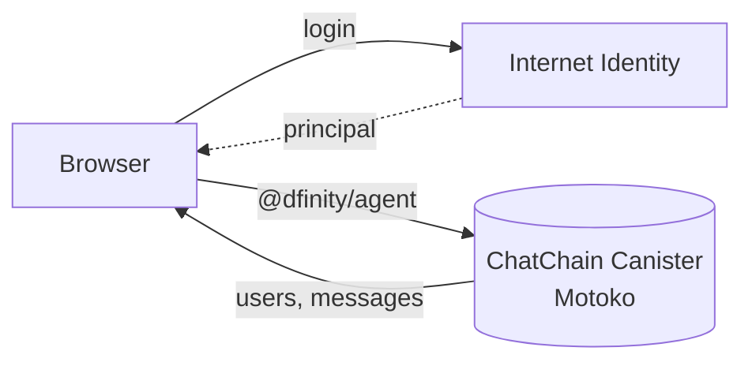
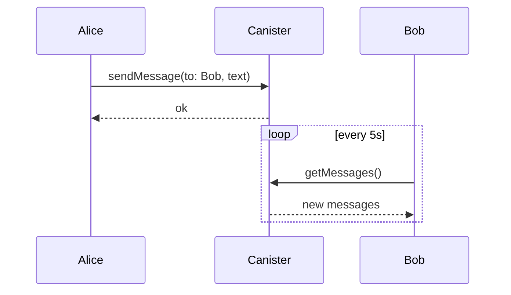

<div align="center">


# ChatChain

**Serverless chat on the Internet Computer.**

Messages live in a Motoko canister, users sign in with Internet Identity, and there is no backend server.

<br />

[](LICENSE)
[](https://internetcomputer.org/)
[](https://internetcomputer.org/docs/current/motoko/main/motoko)
[](https://developer.mozilla.org/en-US/docs/Web/JavaScript)
[](CONTRIBUTING.md)

[Features](#features) •
[Quick Start](#quick-start) •
[Architecture](#architecture) •
[Deployment](#deploy-to-mainnet) •
[Roadmap](#roadmap) •
[Contributing](#contributing)

</div>

---

## Overview

ChatChain is a chat app that runs entirely on the **Internet Computer Protocol (ICP)**. A Motoko canister stores users and messages, **Internet Identity** handles passwordless login, and the frontend is plain JavaScript, HTML, and CSS, so it is easy to read, fork, and extend.

## Features

| | Feature | Description |
|---|---|---|
| 🔗 | **Decentralized messaging** | Users and messages are stored in an ICP canister, with no central server |
| 🔐 | **Internet Identity** | Passwordless, privacy-preserving sign-in |
| 📱 | **Responsive UI** | Gradient interface with a user list, chat window, and settings modal |
| 🔄 | **Live updates** | The client polls for new messages every 5 seconds |
| 🌐 | **Easy to extend** | Vanilla JS and Motoko, with no framework to learn |

## Quick Start

### Prerequisites


Install the DFX SDK:

```bash
sh -ci "$(curl -fsSL https://internetcomputer.org/install.sh)"
```

You also need [Node.js](https://nodejs.org) 16 or later.

### Run locally

```bash
# Clone
git clone https://github.com/KelvCodes/ChatChain.git
cd ChatChain

# Install dependencies
npm install

# Start the local replica
dfx start --background

# Deploy canisters
dfx deploy
```

Then set your backend canister ID in `src/frontend/assets/js/index.js`:

```js
const canisterId = '<your-backend-canister-id>'; // from `dfx canister id ChatChain_backend`
const host = 'http://127.0.0.1:4943';
```

Start the frontend:

```bash
npm start
```

Open **http://localhost:9000**.

> [!TIP]
> Get your canister ID with `dfx canister id ChatChain_backend`.

### Try it out

1. Open the app and click the gear icon to log in with **Internet Identity**.
2. Enter a username to register.
3. Pick a user from the list.
4. Send a message. It is stored in the canister and refreshes every 5 seconds.

## Architecture





<details>
<summary><b>Project structure</b></summary>

```text
ChatChain/
├── src/
│   ├── frontend/
│   │   ├── assets/
│   │   │   ├── css/styles.css
│   │   │   └── js/index.js
│   │   ├── declarations/ChatChain/    # Generated bindings
│   │   └── index.html
│   └── backend/
│       └── main.mo                    # Motoko canister
├── dfx.json
├── package.json
└── webpack.config.js
```

</details>

## Tech Stack

| Layer | Technology |
|---|---|
| Smart contract |  |
| Blockchain |  |
| Auth | Internet Identity |
| Frontend |    |
| Bundler |  |
| ICP libraries | `@dfinity/agent`, `@dfinity/auth-client`, `@dfinity/identity` |
| SDK | DFX 0.15+ |

## Deploy to Mainnet

```bash
dfx deploy --network ic
```

Update `index.js` with your mainnet values:

```js
const canisterId = '<your-mainnet-backend-canister-id>';
const host = 'https://icp-api.io';
```

Your app will be live at `https://<frontend-canister-id>.icp0.io`. You can also host the frontend elsewhere (for example on Vercel) and point it at the mainnet backend canister.

> [!IMPORTANT]
> Mainnet deploys cost cycles. Make sure your cycles wallet is funded before running `dfx deploy --network ic`.

## Development Notes

<details>
<summary><b>Run Internet Identity locally</b></summary>

```bash
dfx deploy internet_identity --network local
```

Then update `index.js` with the local Internet Identity canister ID.

</details>

<details>
<summary><b>Regenerate canister bindings</b></summary>

Run this after changing `main.mo`:

```bash
dfx generate ChatChain_backend
```

</details>

<details>
<summary><b>Reset local state</b></summary>

```bash
dfx start --clean --background
```

</details>

## Known Limitations

> [!WARNING]
> ChatChain is a learning project and is not production-ready yet.

| Limitation | Details |
|---|---|
| Polling | Updates arrive every 5 seconds, not instantly |
| Online status | All users appear online, as there is no presence tracking |
| Storage | Data is held in memory, so it can be lost on canister upgrade unless moved to stable storage |
| Auth checks | Unregistered users can still send messages. `registerUser` should enforce this |

## Roadmap

- [x] Internet Identity login
- [x] User registration
- [x] On-canister messaging
- [x] Polling for new messages
- [ ] Stable storage so data survives upgrades
- [ ] Enforce registration before messaging
- [ ] Private messages scoped to recipient principals
- [ ] Pagination for message history
- [ ] Message deletion with auth checks
- [ ] Real online and offline presence
- [ ] File sharing (metadata on-chain, large files across canisters)

## Contributing

Contributions are welcome, whether it's a bug fix, a feature, docs, or an idea.

```bash
git checkout -b feature/your-feature
git commit -m "Add your feature"
git push origin feature/your-feature
```

Then open a Pull Request.

## License

Released under the [MIT License](LICENSE).

<div align="center">

<br />

Built with 🖤 on the Internet Computer. No servers, no limits.

[](https://github.com/KelvCodes)

⭐ **Star this repo if you like decentralized apps.**

</div>
